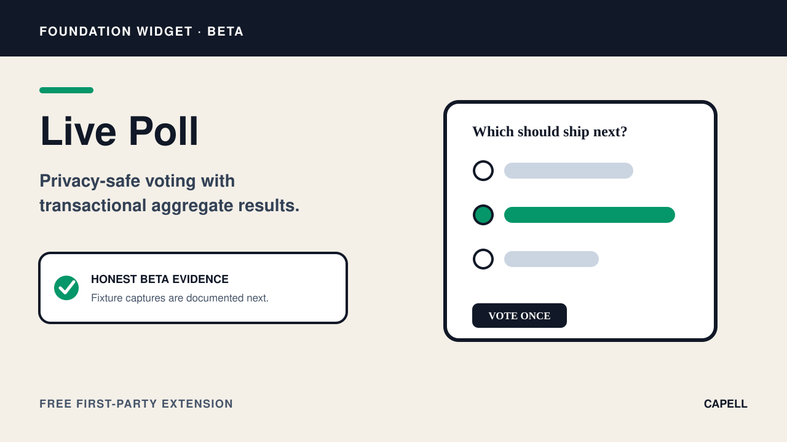
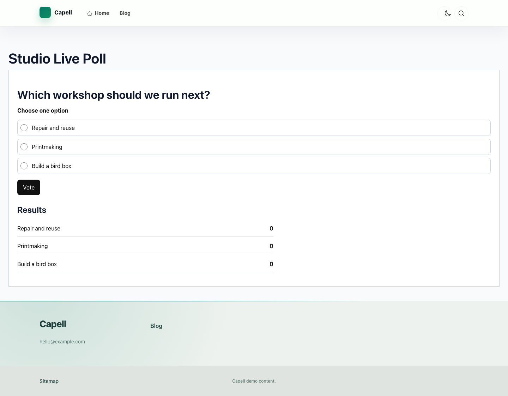

# Live Poll Widget

<!-- prettier-ignore-start -->

## What This Plugin Adds

Live Poll Widget is an **Available**, **Schema-owning** Capell package in the **Capell Foundation** product group. It ships as `capell-app/widget-live-poll` and extends these surfaces: admin, frontend, console.

Live Poll adds persisted polls, options, votes, public voting endpoints, and voter-retention cleanup to a Layout Builder widget. Result visibility and repeat-vote behavior are enforced by the poll domain Actions.

Editors configure locale-specific polls in Layout Builder, and visitors can vote and see results only when the configured visibility policy permits it.

Status details:

- Status: Available
- Tier: free
- Bundle: foundation
- Composer package: `capell-app/widget-live-poll`
- Namespace: `Capell\WidgetLivePoll`
- Theme key: not applicable

## Why It Matters

**For developers:** Voting, publication sync, payload resolution, rate controls, and retention are separated into Actions and provider configuration with feature coverage.

**For teams:** Teams can collect a bounded audience response on the page while controlling when aggregate results become public.

## Screens And Workflow

Screenshot contract: `docs/screenshots.json`.

- Live Poll Widget extension card (marketplace, required evidence).
- Live Poll fields in Layout Builder (admin, supplementary evidence).
- Live Poll public output (frontend, required evidence).
- Live Poll fields in Layout Builder with admin sidebar menu open (admin, supplementary evidence).

## Technical Shape

### Service providers

- `Capell\WidgetLivePoll\Providers\WidgetLivePollServiceProvider`

### Config files

- `packages/widget-live-poll/config/capell-widget-live-poll.php`

### Migrations

- `packages/widget-live-poll/database/migrations/2026_07_09_000001_create_capell_polls_table.php`
- `packages/widget-live-poll/database/migrations/2026_07_09_000002_create_capell_poll_options_table.php`
- `packages/widget-live-poll/database/migrations/2026_07_09_000003_create_capell_poll_votes_table.php`

### Models

- `Poll`
- `PollOption`
- `PollVote`

### Filament classes

- `LivePollWidget`

### Route files

- `packages/widget-live-poll/routes/web.php`

### Listeners

- `SyncPublishedPollsListener`

### Actions

- `CastPollVoteAction`
- `PruneClosedPollVotersAction`
- `ResolveLivePollPayloadsAction`
- `SyncPublishedPollAction`

### Data objects

- `LivePollInputData`
- `LivePollRenderData`
- `LivePollRenderOptionData`
- `PollOptionInputData`
- `PollPublicationData`
- `PollVoteResultData`

### Scheduled commands

- `capell:polls:prune-voters (daily; package registered)`

### Console command classes

- `PrunePollVotersCommand`

### Manifest contributions

- `content-widget: Capell\WidgetLivePoll\WidgetLivePollContribution`
- `scheduled-job: Capell\WidgetLivePoll\Manifest\LivePollPruneScheduleContribution`

### Health checks

- `Capell\WidgetLivePoll\Health\WidgetLivePollHealthCheck`

### Blade views

- `packages/widget-live-poll/resources/views/widget.blade.php`

### Cache tags

- `widget-live-poll`

## Data Model

- Required tables: `capell_polls`, `capell_poll_options`, `capell_poll_votes`.
- Models: `Poll`, `PollOption`, `PollVote`.
- Core record references in migrations: `sites via site_id`, `languages via language_id`.
- Migration files: `2026_07_09_000001_create_capell_polls_table.php`, `2026_07_09_000002_create_capell_poll_options_table.php`, `2026_07_09_000003_create_capell_poll_votes_table.php`.
- Migration impact: run host migrations through the package install flow before opening package surfaces.
- Deletion/retention behaviour: migrations declare cascade-on-delete relationships; retention is scheduled through `capell:polls:prune-voters` (daily; registered by the package provider).

## Install Impact

- Required packages: `capell-app/admin`, `capell-app/core`, `capell-app/frontend`, `capell-app/layout-builder`.
- Admin navigation: no admin page or resource contribution is declared.
- Admin/editor extensions: `content-widget: WidgetLivePollContribution`.
- Permissions: no package permission declarations or Shield gates detected; host access rules still apply.
- Public routes: loads `routes/web.php`.
- Database changes: package migrations are declared.
- Config: `config/capell-widget-live-poll.php`.
- Settings: no package settings declared.
- Queues or schedules: scheduled commands `capell:polls:prune-voters (daily; package registered)`.
- Cache tags: `widget-live-poll`.
- Commands: console command classes detected: `PrunePollVotersCommand`.

## Common Pitfalls

- Keep required Capell packages on compatible v4 releases: `capell-app/admin`, `capell-app/core`, `capell-app/frontend`, `capell-app/layout-builder`.
- Run migrations before opening package resources or public routes.
- Review package configuration before production-like verification: `config/capell-widget-live-poll.php`.
- Review middleware, throttling, signatures, and public-output safety in `routes/web.php` before exposing routes.
- Keep the host Laravel scheduler running so package-registered schedules can execute: `capell:polls:prune-voters (daily; package registered)`.
- Keep public Blade and cached HTML free of authoring markers, model IDs, permissions, signed editor URLs, and lazy database queries.
- Custom write integrations must preserve invalidation for `widget-live-poll` cache tags.

## Troubleshooting

| Symptom | Likely cause | Check | Fix |
| --- | --- | --- | --- |
| Package surface is missing after install | Provider or manifest is not loaded | Confirm `capell.json`, package `composer.json`, and provider registration | Reinstall the package, refresh Composer autoload, and clear host caches |
| Admin screen or command fails on missing table | Package migrations have not run | Check the tables listed in `Data Model` | Run host migrations and rerun the focused package test |
| Route returns unexpected output | Route cache, middleware, or signed URL setup does not match the package route file | Check the route files listed in `Technical Shape` | Clear route cache and verify middleware before exposing public routes |
| Background work does not run | Queue worker or declared schedule is not active | Check the jobs and scheduled commands listed in `Technical Shape` | Start the queue worker or host scheduler, then run the focused command or package test |
| Public output leaks unexpected state | Render data, cache variation, or authoring boundary has regressed | Check public Blade, cache tags, and public-output safety tests | Move data loading out of Blade and rerun the package public-output tests |

## Quick Start

1. Install the package: `composer require capell-app/widget-live-poll`.
2. Open the package detail or install-intent surface and confirm the Live Poll Widget extension card is present.

## Next Steps

- [Package docs](docs/README.md)
- [Overview](docs/overview.md)
- Configuration files: [`config/capell-widget-live-poll.php`](config/capell-widget-live-poll.php).
- [Troubleshooting](#troubleshooting)
- [Screenshot contract](docs/screenshots.json)
- [Marketplace assets](docs/assets/marketplace/)
- [Capell content language plan](../../docs/CONTENT_LANGUAGE_PLAN.md)
- [Capell documentation design system](../../docs/DESIGN_SYSTEM.md)
- [Capell and package ERD notes](../../docs/erd/capell-and-package-erds.md)
- Related packages: [Layout Builder](../layout-builder/README.md).

<!-- prettier-ignore-end -->
