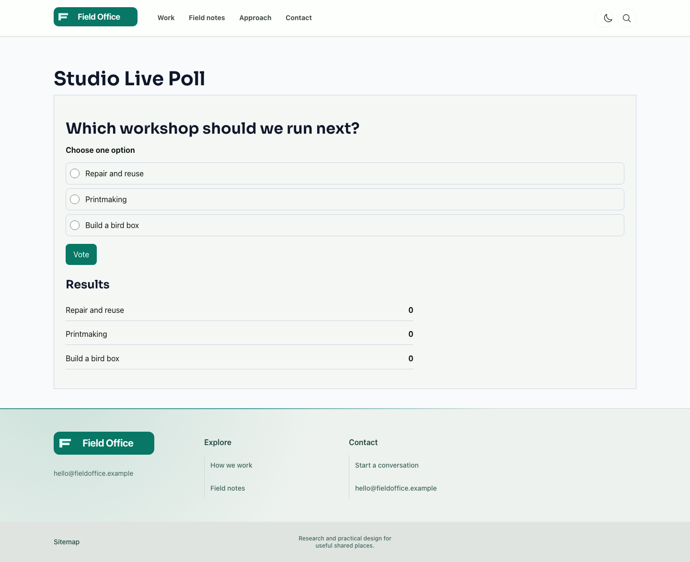
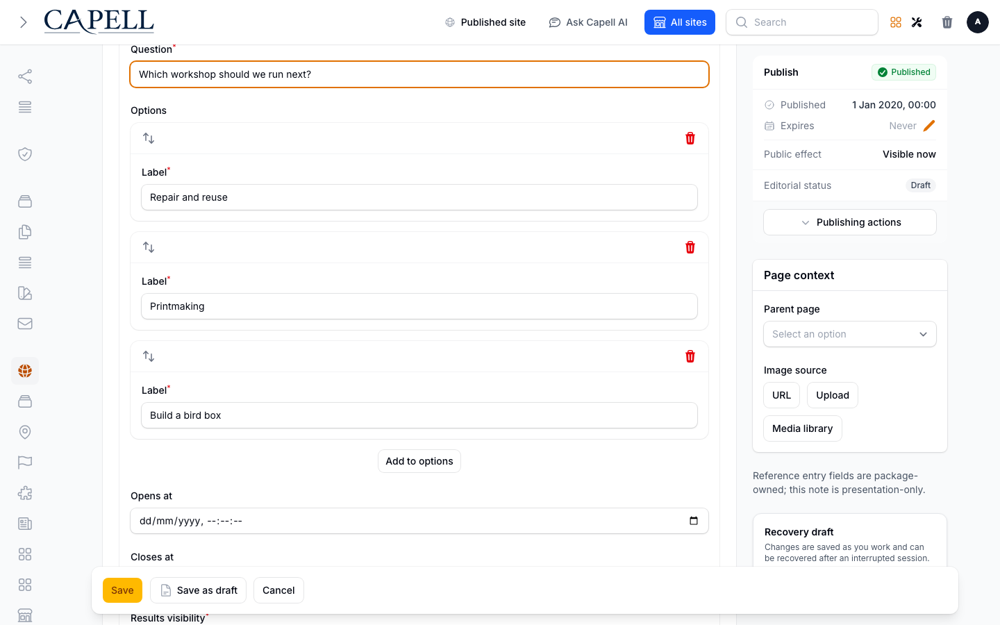

# Live Poll Widget

<!-- prettier-ignore-start -->

When a club wants a quick show of hands on its next outing, a poll on the page will do it. Visitors see one question with up to ten answers. They pick one and press Vote.

The totals appear when you say. Show them to everyone from the start, only to people who've voted, or only once the poll closes on a date you set. They're plain counts for each answer, without percentages or bars. They're current when the page loads and refresh when someone votes.

Each browser gets one vote per poll. Pressing Vote twice won't count twice, though someone with a second phone could vote again. Treat it as a friendly poll, not a ballot.

To remember who has voted, the poll sets one cookie in the visitor's browser. Your site keeps only a scrambled copy of it, and never stores their internet address with the vote, only a one-day scrambled count of votes from it. Clearing the cookie doesn't allow unlimited voting, because one internet address can cast 25 votes on a poll in a day. Once a poll has a closing date, voter records are deleted ninety days after it and the totals stay. If you chose to show results after closing, everyone sees the final totals from closing time.

- **Price and availability:** Check current availability and price on the [Capell Marketplace listing](https://capell.app/marketplace/extensions/widget-live-poll).
- **Licence:** Check the licence terms on the [Capell Marketplace listing](https://capell.app/marketplace/extensions/widget-live-poll).
- **Requires:** `PHP ^8.4`, `capell-app/admin ^1.0`, `capell-app/core ^1.0.79`, `capell-app/frontend ^1.0.79`, `capell-app/layout-builder ^1.0`, `laravel/framework ^12.0 || ^13.0`, `lorisleiva/laravel-actions ^2.8`, `spatie/laravel-package-tools ^1.0`.
- **Install:** `composer require capell-app/widget-live-poll:@beta`.

## Quick Start

1. Install the package: `composer require capell-app/widget-live-poll:@beta`.
2. Open a page, click **Layout builder**, **Add widgets**, then choose **Live Poll**.

## For Developers

Voting, publication sync, payload resolution, rate controls, and retention are separated into Actions and provider configuration with feature coverage.

## Configure

- **Configuration files:** `config/capell-widget-live-poll.php`.

## Limits And Pitfalls

- Install the required Capell packages at the versions in `composer.json`: `capell-app/admin ^1.0`, `capell-app/core ^1.0.79`, `capell-app/frontend ^1.0.79`, `capell-app/layout-builder ^1.0`.
- Run migrations before opening package resources or public routes.
- Review middleware, throttling, signatures, and public-output safety in `routes/web.php` before exposing routes.
- Keep the host Laravel scheduler running so package-registered schedules can execute: `capell:polls:prune-voters (daily; package registered)`.
- Keep public Blade and cached HTML free of authoring markers, model IDs, permissions, signed editor URLs, and lazy database queries.
- Custom write integrations must preserve invalidation for `widget-live-poll` cache tags.

## Screens And Workflow

- Live Poll Widget extension card (marketplace).
- Live Poll fields in Layout Builder (admin).
- Live Poll public output (frontend).
- Live Poll fields in Layout Builder with admin sidebar menu open (admin).

## Install Impact

- Required packages: `capell-app/admin`, `capell-app/core`, `capell-app/frontend`, `capell-app/layout-builder`.
- Admin navigation: no admin page or resource contribution is declared.
- Admin/editor extensions: `content-widget: WidgetLivePollContribution`.
- Permissions: no package permission declarations or Shield gates detected; host access rules still apply.
- Public routes: loads `routes/web.php`.
- Database changes: package migrations are declared.
- Config: `config/capell-widget-live-poll.php`.
- Settings: no package settings declared.
- Queues or schedules: scheduled commands `capell:polls:prune-voters (daily; package registered)`.
- Cache tags: `widget-live-poll`.
- Commands: console command classes detected: `PrunePollVotersCommand`.

## Troubleshooting

| Symptom | Likely cause | Check | Fix |
| --- | --- | --- | --- |
| Package surface is missing after install | Provider or manifest is not loaded | Confirm `capell.json`, package `composer.json`, and provider registration | Reinstall the package, refresh Composer autoload, and clear host caches |
| Admin screen or command fails on missing table | Package migrations have not run | Check the tables listed in `Data Model` | Run host migrations and rerun the focused package test |
| Route returns unexpected output | Route cache, middleware, or signed URL setup does not match the package route file | Check the route files listed in `Technical Shape` | Clear route cache and verify middleware before exposing public routes |
| Background work does not run | Queue worker or declared schedule is not active | Check the jobs and scheduled commands listed in `Technical Shape` | Start the queue worker or host scheduler, then run the focused command or package test |
| Public output leaks unexpected state | Render data, cache variation, or authoring boundary has regressed | Check public Blade, cache tags, and public-output safety tests | Move data loading out of Blade and rerun the package public-output tests |

## Upgrading

No manual steps between minor versions.

## Next Steps

- [Package docs](docs/README.md)
- [Overview](docs/overview.md)
- Configuration files: [`config/capell-widget-live-poll.php`](config/capell-widget-live-poll.php).
- [Troubleshooting](#troubleshooting)
- [Developer reference](docs/reference.md)
- [Marketplace assets](docs/assets/marketplace/)
- [Capell content language plan](../../docs/CONTENT_LANGUAGE_PLAN.md)
- [Capell documentation design system](../../docs/DESIGN_SYSTEM.md)
- [Capell and package ERD notes](../../docs/erd/capell-and-package-erds.md)
- Related packages: [Layout Builder](../layout-builder/README.md).

<!-- prettier-ignore-end -->
